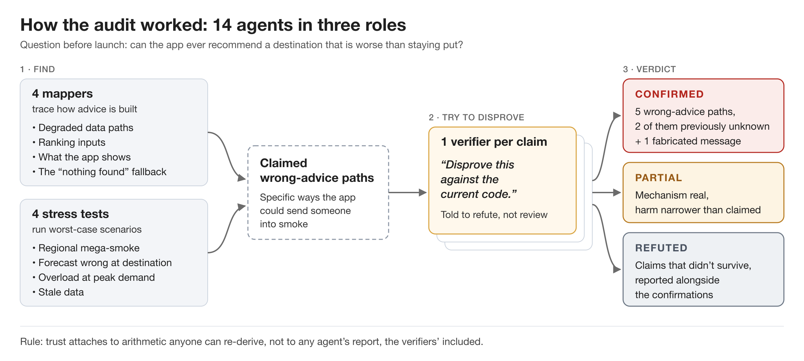

# Can My App Give Dangerous Advice?

*I sent 14 AI agents to find out.*

Over the summer, I started building Break Clear, an iOS app under development for use in wildfire season. The idea is simple: when wildfire smoke rolls in, the app combines hourly EPA AirNow station readings with a 72-hour Open-Meteo (CAMS) air quality forecast to rank destinations within a 6-hour drive that are most likely to have healthy air.

Before a public launch, I set one hard bar: I don't want to recommend a bad destination. Route danger stays out of scope as a data problem. Apple Maps handles road warnings, and the app carries explicit trip-planning disclaimers. For air quality, my acceptable worst case is an honest dead end telling the user there are no qualifying escapes within 6 hours. What worried me were two failure modes: sending someone into worse air than they started in, or failing to flag a real escape (or the need for one) because current conditions were misread.

## How the audit worked

On August 12, 2026, I used Claude Code to run a 14-agent audit against the main branch across three roles:

- Four mappers tracing degraded paths, ranking inputs, client presentation, and the "nothing found" fallback ladder.
- Four scenario stress-testers probing regional mega-smoke, forecast error at the destination, peak-load degradation, and stale data.
- Independent adversarial verifiers—one per claimed wrong-advice path—explicitly instructed to refute each claim against the current codebase. Partial and full refutations went into the report alongside confirmations.

I built the verifier role around refutation on purpose. Ask an AI agent for a general review and it leans agreeable. My bet was that telling it to disprove a specific failure claim would produce sharper scrutiny.

## What held up

Under regional mega-smoke, the core safety invariant held. When nothing clears the improvement threshold, the backend returns EMPTY_HONEST ("No destination beats your air by enough right now — staying put is the honest answer"), never a "least-bad" list.

In a Claude Code session, I verified this live in production: querying Yakima, WA with a 3-hour driving budget returned an empty list and named the nearest qualifying escape (Pullman) as outside the budget rather than lowering the bar. Across roughly 15 mapped degraded paths, most were already honestly labeled, and adversarial verification confirmed one suspected client-side bug had already been fixed, and another turned out to be correct behavior.

## Where the logic broke

Adversarial verification confirmed five wrong-advice paths—three already tracked as open high-priority issues and two previously untracked—plus one client-side fabrication, also untracked. Three illustrate the range of what slipped through:

1. Stale monitor confirming a clean model (untracked). There was no recency check on the station anchor. Typical monitor lag runs 1 to 2.5 hours, stretching to ~12 hours during an AirNow outage. Because smoke fronts move at 20 to 50 km/h, a stale clean reading lets a bad card through—and worse, when the forecast correctly predicts incoming smoke, a stale clean anchor can actively scale the true forecast down by up to 20x.

2. Fabricated certainty during an outage (untracked). When forecast data came back empty under peak-load budget exhaustion, the iOS client mapped an empty array to the same state as a 72-hour never-clears forecast. The detail view, home-screen widget, and Live Activity all reported "Not in the next 3 days"—inventing a worst-case timeline at the exact moment users needed honest uncertainty.

3. Unscored ozone (tracked). Origin air quality was evaluated across all pollutants, while destinations were scored strictly on PM2.5. Destination ozone was fetched but never gated, meaning on an ozone-driven day the app could confidently send someone on a drive into ozone as bad as what they left.

## A live catch in production

Break Clear uses bias correction to blend live hourly monitor readings with the multi-day forecast. Later the same day, a Claude Code session scanned eight smoky Northwest origins in production and caught an active failure.

At Sandpoint, ID, the observed AirNow AQI was 93 (Moderate), setting the destination threshold at 68. The sixth recommended card pointed to Priest Lake, 49 minutes away, where the matched monitor read 138 (Unhealthy for Sensitive Groups). Over the next nine hours, the bias-corrected forecast sat at 147–152. Yet the card slipped past the gate because the ranking code compared Sandpoint's instantaneous reading (93) against Priest Lake's 48-hour forecast mean (65). As the report put it, "The bias correction worked; the gate averaged the plume away." Worse, a wording bug on that same card described the worsening air as "dips to Unhealthy by Fri."

## Auditing the auditors

The workflow caught bugs in the app, and checking the workflow caught errors in my agents' conclusions. Three same-day conclusions had to be reversed: a claim about which proposed guard actually blocked the Priest Lake card, a merge-conflict count on an existing fix branch, and a claim about what state had been pushed.

Every one of those errors read smoothly in prose. Every reversal came from re-deriving the numbers directly against the code and live outputs. That has become my default rule when working with agents: use them to inspect and refute against the source of truth, but attach trust to reproducible arithmetic, never to an assertion.

## Fixing what the audit found

Closing the severe failure modes came down to a bounded set of roughly nine changes, eleven by the end of the day. Agents closed ten of them that evening and I did one myself, which left no high-priority issue open. The single highest-leverage fix was gating directly on observed current air at the destination, which blocks cards like Priest Lake outright (138 vs. 68).

One product trade-off was settled that day but not yet shipped. The relative "less bad" gate stays, because in regional mega-smoke harm reduction can be the right advice, and it still requires a destination to clearly beat your own air. The "still unhealthy" advisory is based on observed current air and worst stay conditions (max(observed, stayWorst) > 100), never on a 48-hour mean that can mask an active plume.

## Beyond one app

As consumer software and AI agents take on more consequential advice, the hard question is who audits the outputs and how they do so. Break Clear runs deterministic ranking code, yet much of it was built with non-deterministic AI systems. Traditional tests verify that code runs as written; they rarely catch semantic failures like averaging away an active hazard or silently dropping a fetched pollutant.

This was one app, tested on one day, with Anthropic's Claude agents auditing code Claude helped write, and with no ordinary review to compare against. Running the same audit across multiple model families would likely surface different blind spots and different refutations.

Provenance: The [full technical report](docs/bad-advice-analysis-2026-08-12.md), written by Claude agents, cites code by file, function or commit as it stood at commits 25e4e4d/4d5daf8 (2026-08-12). The originating agent transcripts no longer exist, and nothing depends on them. The arithmetic for one finding not covered here (a bias-correction decay artifact) was re-derived from source in November 2026 and matched, and later corrections are documented inline rather than overwritten. This repo was extracted from the private Break Clear app repo; commit dates are original, and each commit was trimmed for publication (API paths put in words, session links removed). The public copy of the report omits its last two sections, which "Fixing what the audit found" summarizes.
